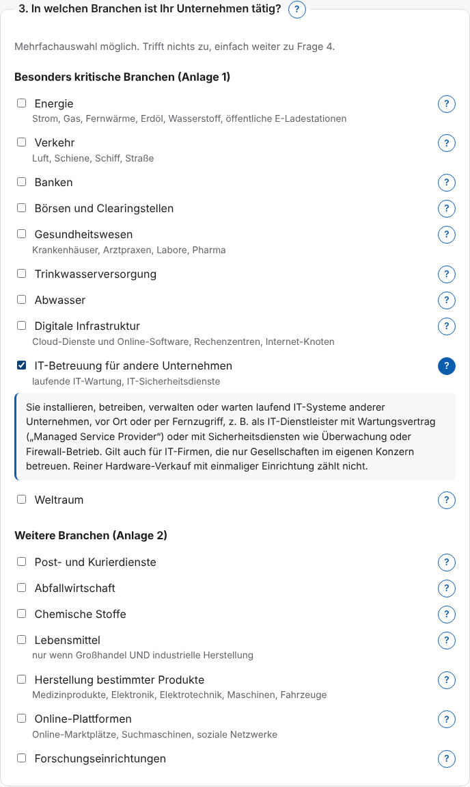
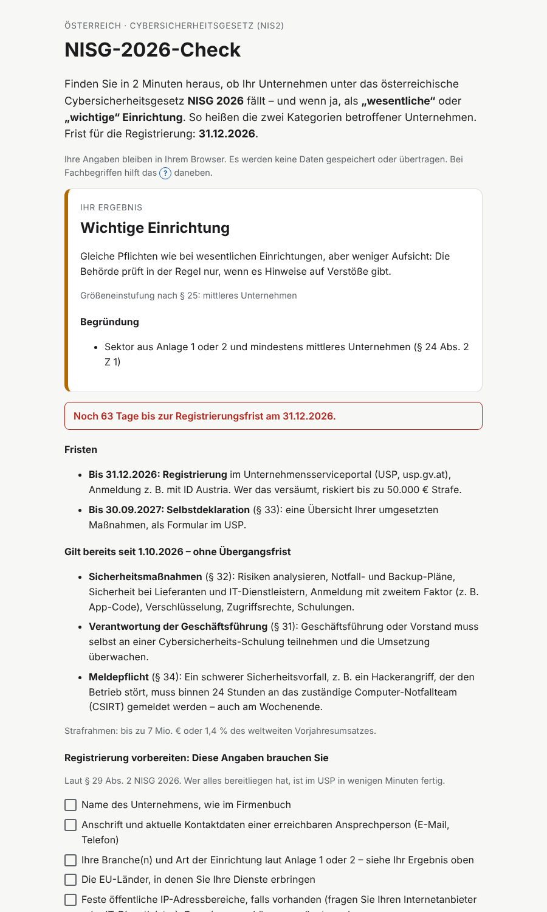
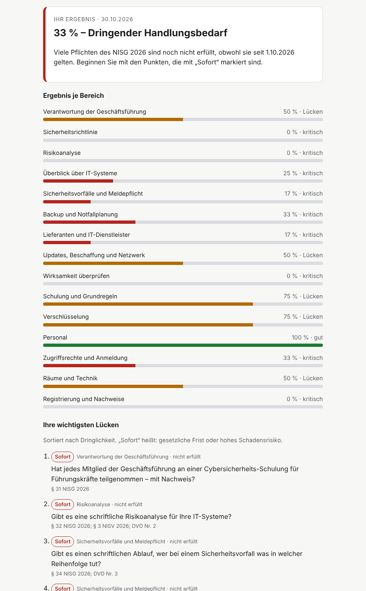

# NISG 2026 Checker & Security Self-Assessment (Austria / NIS2)

[](https://github.com/norbert-eigner/nisg2026-check/actions/workflows/test.yml)

Two free, privacy-friendly web tools that help Austrian companies with the national NIS2 law, the **Netz- und Informationssystemsicherheitsgesetz 2026 (NISG 2026)**:

1. **NISG-2026-Check:** answers *"Are we affected?"* in four questions and two minutes: essential entity, important entity or not affected, each with the legal basis.
2. **Security self-assessment:** answers *"How far are we from compliant?"* with 36 questions across 15 areas, a traffic light per area and a prioritised gap list.

**Live:** https://clickblvd.com/nisg-check/ · **Language of the tools:** German (target audience: Austrian SMEs)

| Checker: plain-language questions | Checker: result with deadlines | Self-assessment: gap report |
|---|---|---|
|  |  |  |

## Why I built it

NISG 2026 has applied since **1 October 2026**, with no transition period for the security measures. Every affected entity must classify itself and register with the authority via the USP portal by **31 December 2026**. Most SMEs don't know whether they are in scope, and the legal text is hard to read. These tools translate the law into transparent, testable decision logic and plain German.

## What it does

**Checker (`index.html`)**
- Classifies an entity under §§ 24–25 NISG 2026 as *wesentlich* (essential), *wichtig* (important), not affected, or out of territorial scope
- Explains every result with the exact legal reference
- Separates deadlines (registration 31.12.2026, self-declaration 30.09.2027) from duties that already apply (§§ 31, 32, 34)
- Shows a countdown and a checklist of the eight data points needed for registration (§ 29 Abs. 2)
- Every technical term has a "?" explanation in everyday language

**Self-assessment (`gap.html`)**
- 36 questions in 15 areas, built on § 32 NISG 2026, the Austrian NIS-Verordnung (NISV 2026, BGBl. II Nr. 290/2026) and the 13 sections of the annex to EU Implementing Regulation 2024/2690, which § 2 NISV makes binding for all essential and important entities
- Score per area with a traffic light (≥ 80 % good, 50–79 % gaps, < 50 % critical)
- Gap list prioritised by legal deadlines and damage risk, each gap traced back to its legal source
- Export as PDF via the browser's print function

## Security and privacy by design

- **100 % client-side:** no backend, no database, no cookies, no tracking. Answers never leave the browser.
- **Strict Content Security Policy** (`script-src 'self'; style-src 'self'`): no inline scripts or styles anywhere, so injected code can't run
- **XSS-safe rendering:** the UI is built with `createElement` and `textContent`, never `innerHTML`
- **Hardened hosting:** HSTS, CSP, X-Frame-Options, Referrer-Policy, Permissions-Policy, HTTPS and non-www redirects, blocked dotfiles and backups. Config in [`deploy/.htaccess`](deploy/.htaccess)
- **Domain security:** CAA records, SPF, DKIM and DMARC for the domain, plus an RFC 9116 [`security.txt`](deploy/security.txt)
- **Lead capture without data storage:** the feedback button opens the visitor's own e-mail client with a pre-filled draft. Nothing is sent unless they choose to send it.
- **Accessible:** keyboard-operable, ARIA states on all toggles, works with screen readers, dark mode

## Legal logic

| Rule | Implementation | Source |
|---|---|---|
| Large: ≥ 250 employees, or turnover > €50M **and** balance sheet > €43M | `sizeClass()` in `logic.js` | § 25 Abs. 2 |
| Medium: ≥ 50 employees, or turnover > €10M **and** balance sheet > €10M | `sizeClass()` | § 25 Abs. 3 |
| Essential: size-independent roles (QTSP, TLD, DNS, federal administration, critical entities), telecom from medium size, Annex 1 + large | `classify()` step 1 | § 24 Abs. 1 |
| Important: Annex 1/2 + at least medium, state administration, telecom and trust service providers of any size | `classify()` step 2 | § 24 Abs. 2 |
| Essential takes precedence over important | early `return` | § 24 Abs. 2 (last sentence) |

## Tests

```bash
npm test
```

- `test.js`: 22 tests for the classification, including the exact boundary values of § 25 (49 vs 50 employees, €10M vs €10.01M)
- `test-gap.js`: 11 tests for scoring, prioritisation and catalogue integrity
- GitHub Actions runs all tests on every push (badge above)
- The UI was also tested in headless Chromium under the production CSP: zero policy violations

## Project structure

```text
index.html      Checker page
logic.js        Classification logic (pure functions, testable in Node)
app.js          Checker UI
gap.html        Self-assessment page
gap-data.js     Question catalogue (36 questions, 15 areas, legal references)
gap-score.js    Scoring and prioritisation (pure functions)
gap.js          Self-assessment UI and report
style.css       Shared styles, light/dark, print
deploy/         Apache .htaccess (security headers) and security.txt
test.js         Tests for logic.js
test-gap.js     Tests for gap-score.js and the catalogue
```

## Run locally

No build step and no dependencies. Open `index.html` in a browser, or use a local server such as the VS Code "Live Server" extension. Run the tests with Node.js 18 or newer.

## Limitations

- A first assessment, **not legal advice** and not an audit under § 33 Abs. 2 NISG 2026
- Group aggregation (linked and partner enterprises) must be entered manually
- Individual designation by official decision (§ 26) is not modelled
- Scoring weights in the self-assessment are a transparent rule of thumb, not a legal weighting

## Sources

- [NISG 2026, BGBl. I Nr. 94/2025 (RIS)](https://www.ris.bka.gv.at/eli/bgbl/I/2025/94/20251223)
- [WKO/BMI FAQ on NISG 2026](https://www.wko.at/it-sicherheit/nis-faq)
- [NISV 2026 summary (KPMG)](https://kpmg.com/at/de/insights/2026/10/nisv-2026.html)
- [Implementing Regulation (EU) 2024/2690](https://eur-lex.europa.eu/legal-content/DE/TXT/HTML/?uri=OJ:L_202402690)
- [ENISA implementation guidance](https://www.enisa.europa.eu/publications/implementation-guidance-on-nis-2-security-measures)

Legal status: 25 October 2026.

## Author

Norbert Eigner · [LinkedIn](https://linkedin.com/in/norbert-eigner) · [GitHub](https://github.com/norbert-eigner)

Licensed under the MIT License.
